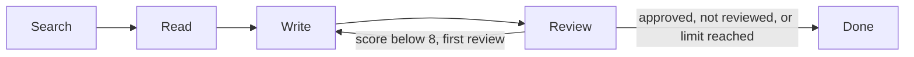

# Multi-Agent Research Assistant

Type a topic and four AI agents search the web, read the pages, write a sourced report, and review it. You watch the work happen in a chat, read the report on a canvas, and can ask follow-up questions or request edits afterwards.


<!--
## Live demo

- App: https://deep-dive-nu.vercel.app
- API docs: https://deepdive-api-ai5h.onrender.com

(Free hosting can take about 30 seconds to wake up on the first request.)
Remove this comment markup once the links are real.
-->

## Features

- **Four-agent pipeline** built with LangGraph: Search, Read, Write, Review
- **Review loop:** a critic scores the draft and sends it back for a revision when it finds problems
- **Fresh sources:** recent-only searches plus a news search, with published dates passed to the writer
- **Numbered citations** like `[1]`, with the Sources list built in code from real titles and URLs, not written by the model
- **Live progress** streamed to the browser with Server-Sent Events
- **Chat and canvas UI:** agent updates appear as chat messages, and the report appears next to them
- **Follow-ups:** ask questions about the report or request changes ("make it shorter")
- **History** saved in the browser, plus Copy and Download as Markdown

## How it works



| Agent | What it does |
|---|---|
| **Search** | An LLM writes 3 queries (including one for the current state of the topic and one news search). Tavily returns the sources with published dates, newest first, and up to 7 are kept. |
| **Read** | Fetches each page, strips scripts and navigation, and falls back to Tavily's snippet if a page can't be read. Sources are numbered after filtering, so `[n]` always matches. |
| **Write** | Writes a short report that only uses the provided sources, cites them by number, and says "as of" when figures are old. |
| **Review** | Checks that claims are supported by the cited source, flags outdated or uncited claims and missing coverage, and returns a score from 1 to 10. A score below 8 triggers one revision. |

If the review itself fails, the draft is shown as "not reviewed" instead of getting a made-up score.

## Tech stack

- **Backend:** Python, FastAPI, LangGraph, LangChain, Groq (`openai/gpt-oss-120b`), Tavily, BeautifulSoup, sse-starlette
- **Frontend:** React 19, Vite, Tailwind CSS 4, react-markdown

## Project structure

```
.
├── backend
│   ├── main.py            # FastAPI app: /api/research (SSE) and /api/followup
│   ├── graph.py           # LangGraph workflow and revision routing
│   ├── agents
│   │   ├── nodes.py       # Search, Read, Write and Review agents
│   │   └── state.py       # Shared state and the critic's output schema
│   ├── test_agents.py
│   └── requirements.txt
└── research-ui
    └── src/App.jsx        # Chat, canvas and history UI
```

## Getting started

You need Python 3.11 or newer (developed on 3.13), Node.js (a current LTS release that Vite supports), a [Groq API key](https://console.groq.com) and a [Tavily API key](https://tavily.com).

### 1. Backend

```bash
cd backend
python3 -m venv .venv
source .venv/bin/activate   # Windows: .venv\Scripts\activate
pip install -r requirements.txt
cp .env.example .env        # then add your keys
uvicorn main:app --reload
```

The API runs on `http://localhost:8000`. Always start it from the `backend/` folder, because the imports and the `.env` file are relative to it.

`.env`:

```
GROQ_API_KEY=your_groq_key
TAVILY_API_KEY=your_tavily_key
```

### 2. Frontend

```bash
cd research-ui
npm install
npm run dev
```

Open the URL Vite prints (usually `http://localhost:5173`). If the API is not on `http://localhost:8000`, create `research-ui/.env` with:

```
VITE_API_URL=http://your-api-host:port
```

## Usage

1. Enter a topic, or pick an example, and select **Research**.
2. Watch the agents report progress in the chat. The draft appears on the canvas, and reviewer notes appear when a draft is rejected.
3. Ask about the report, or request a change such as "explain it simply". A revised report is marked **Not reviewed**, because it skips the critic.
4. Use **Copy** or **Download .md** to take the report with you. Past research stays in the sidebar.


## Challenges

- **Token rate limits.** Groq's free tier allows about 8,000 tokens per minute for this model. The pipeline budgets its tokens (a source cap, per-source text limits, a short critic context, low reasoning effort) and retries `429` errors using the wait time Groq reports.
- **Stale results.** Searches are limited to the last year, with an extra news search for the last month. Published dates reach the writer, and the critic flags outdated figures.
- **Streaming reliability.** The React client uses a buffered SSE parser that handles events split across network chunks and the `\r\n` line endings sent by `sse-starlette`, and it shows backend errors in the chat.
- **Scraping failures.** Many sites block scrapers. The Reader falls back to the search snippet, so one blocked page doesn't stop the pipeline.
- **Honest failures.** If the writer or critic call fails, the UI shows the real error or marks the draft "not reviewed", not a fake score.

## Configuration

Settings live at the top of `backend/agents/nodes.py`:

| Setting | Default | Purpose |
|---|---|---|
| `MAX_SOURCES` | 7 | Sources kept after sorting by date |
| `TOTAL_CONTEXT_CHARS` | 8000 | Total source text sent to the writer |
| `CRITIC_CHARS_PER_SOURCE` | 700 | Source text the critic sees per source |
| `PASS_SCORE` | 8 | Minimum score to approve a draft |

The model name is set where each `ChatGroq` client is created. The revision limit is in `should_continue` in `backend/graph.py`. If you have a higher Groq limit, you can raise the budget values.

## Tests

```bash
cd backend
pytest
```

## Known limitations

- **Rate limits:** on a free Groq key a run can pause for several seconds while it waits for the per-minute limit to reset.
- **The reviewer is an LLM.** It verifies claims against the sources, but it can miss errors the sources don't contain.
- **Freshness depends on search.** The report is only as recent as what Tavily finds, so double-check fast-changing figures.
- **Follow-ups don't search the web.** They only use the existing report, so they can rearrange or explain it but not add new facts.
- **History is stored in the browser** (`localStorage`), so it doesn't sync across devices.
- **No authentication, and CORS allows every origin.** Restrict `allow_origins` in `backend/main.py` before deploying.

## Troubleshooting

- **The UI shows nothing:** check that the backend is running and `VITE_API_URL` is correct, then open the browser console and Network tab. Errors from the backend appear in the chat.
- **`413` or `429` from Groq:** you hit the tokens-per-minute limit. Lower `MAX_SOURCES` or `TOTAL_CONTEXT_CHARS`, wait a minute, or use a plan with a higher limit.
- **"Not reviewed":** the critic returned an invalid response twice. Run it again.
- **VS Code shows a `py.typed` error from Pylance:** it is an editor cache problem. Run **Python: Restart Language Server** and check that VS Code uses the interpreter in `.venv`.

## Roadmap

- Clickable citations that jump to the matching source
- A depth selector (quick, standard, thorough)
- Follow-ups that can run a new search
- Reading pages in parallel


## Author

[Prakash Chaudhary](https://github.com/LightChaudhary) · [Portfolio](https://prakashchaudhary.me/)